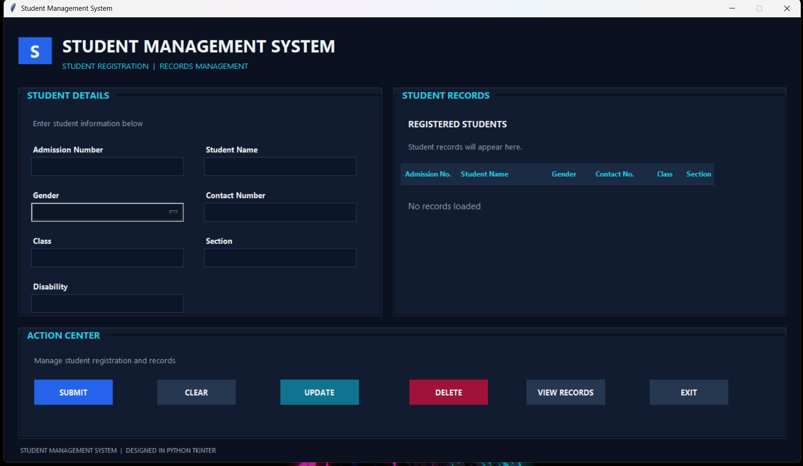
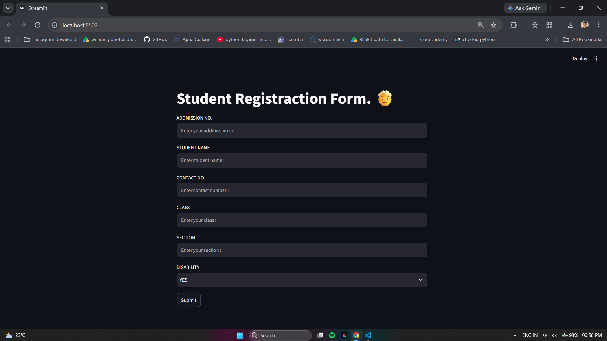

# 🎓 Student Registration System

A complete **Student Registration System** built using **Python, Tkinter, MySQL, and Streamlit**.

This project helps manage student information efficiently with a desktop GUI application and a web-based interface connected with a MySQL database.

---

## 🚀 Features

- ✅ Add new student records
- ✅ View student details
- ✅ Update existing student information
- ✅ Delete student records
- ✅ MySQL database connectivity
- ✅ User-friendly Tkinter desktop interface
- ✅ Streamlit web application
- ✅ CRUD operations implementation

---

## 🛠️ Tech Stack

| Technology | Purpose |
|---|---|
| Python | Core Programming Language |
| Tkinter | Desktop GUI Development |
| MySQL | Database Management |
| Streamlit | Web Application Interface |
| MySQL Connector | Database Connectivity |

---

## 📂 Project Structure

```text
Student-Registration-System/

│
├── student_management_system.py
├── student_registration.py
├── streamlit_app.py
├── database_setup.sql
├── requirements.txt
├── README.md
├── .env.example
│
└── Screenshots/
    ├── main_application.png
    └── streamlit_app.png
```

---

## ⚙️ Installation & Setup

### 1. Clone Repository

```bash
git clone https://github.com/vineetanalytics/Student-Registration-System.git
```

### 2. Open Project Folder

```bash
cd Student-Registration-System
```

### 3. Install Dependencies

```bash
pip install -r requirements.txt
```

---

## 🗄️ Database Setup

1. Open MySQL Workbench.
2. Run the SQL file:

```text
database_setup.sql
```

3. Configure your database credentials.

Example:

```python
host="localhost"
user="your_username"
password="your_password"
database="STUDENT_REGISTRATION_DB"
```

---

## ▶️ How to Run

### Desktop Application (Tkinter)

```bash
python student_management_system.py
```

### Web Application (Streamlit)

```bash
streamlit run streamlit_app.py
```

---

## 📸 Screenshots

### 🖥️ Desktop Application




### 🌐 Streamlit Application



---

## 📚 Learning Outcomes

Through this project, I learned:

- Python GUI development
- Database integration with MySQL
- CRUD operations
- SQL database design
- Streamlit application development
- Git and GitHub project management

---

## 👨‍💻 Author

**Vineet Shukla**

GitHub:
https://github.com/vineetanalytics

---

⭐ If you like this project, consider giving it a star.
